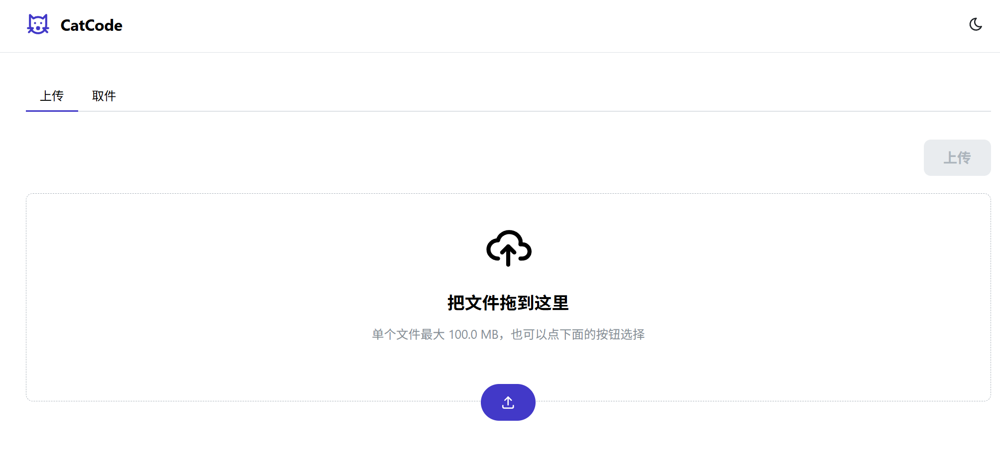

## 我想解决什么问题

我想要的工具是「用完即走」的：上传的人不需要账号，接收的人不需要装 App，两个人在同一个局域网上打开一个网页，输个码，文件就到了。文件到期自动删除，不留下任何东西。

这是我在 ThinkSpirit 的第一个 full-stack 项目。它已经不再只是想法：本机跑通了「上传 → 拿码 → 输码 → 下载 → 到期清理」的完整闭环，前端、后端和数据库都写完了。目前还在补测试和部署，没有公开的 Demo。

## 首版现在能做什么

- 上传：拖入或选择文件（单个 100 MB 以内），服务端生成 6 位取件码，默认 10 分钟有效。字符集去掉了 I、L、O、0、1，避免口播时读错。
- 取件：输入 6 位码，看到文件名、大小、剩余时间和剩余下载次数；也支持 `?code=XXXXXX` 链接直达。
- 下载：服务端流式回传，内存占用与文件大小无关；中文文件名按 RFC 5987 编码，不会变成乱码。
- 到期清理：后台每 30 秒扫描一次，先删数据库记录、再删磁盘文件；启动时还会清理没有记录的孤儿文件。
- 次数限制：默认最多下载 5 次（`MAX_DOWNLOADS` 可配，0 表示不限）。额度用一条带条件的 `UPDATE` 原子占用，两个并发下载不会同时超额。
- 手动焚毁：上传时额外下发一次性 `deleteToken`，删除请求必须带上它。这里修正了最初「凭取件码即可删除」的设计——否则拿到码的接收方也能删掉文件。

**暂不做：** 用户账号、断点续传、多文件打包、病毒扫描、二维码、图片预览、Docker。首版仍然只解决「临时中转一份文件」。

## 现在的样子

上传页只有拖拽区和一个上传按钮，取件入口在旁边的 Tab 里。首页卡片用的也是这张图。

## 一条完整的使用路径

1. 上传方把 PDF 拖进上传页，前端用 `FormData` 调用 `POST /api/files`，进度条来自 `onUploadProgress`。
2. multer 把文件以 UUID 为名落到 `uploads/`，服务端生成取件码和 `deleteToken`，把元信息写进 SQLite。
3. 页面显示取件码和剩余时间。
4. 取件方切到「取件」，输入 `K3X9PA`；`GET /api/files/K3X9PA` 只返回元信息，不消耗下载次数。
5. 点「下载」请求 `GET /api/files/K3X9PA/download`：后端先原子占用一次额度，再用 `fs.createReadStream` 把文件流式回传。
6. 文件到期或被手动焚毁后，数据库记录和磁盘文件一起消失。

## 技术与数据

- 前端：React 19 + Vite + Mantine 9，上传和取件两个 Tab，取件码用 6 位 `PinInput`。构建产物由 Express 直接托管，前后端同源，不用单独部署。
- 后端：Node.js + TypeScript（`tsx` 开发、`tsc` 构建），Express 5 + multer。
- 数据库：better-sqlite3。`files` 表只存元信息，文件本体放在 `uploads/`，磁盘名用 UUID，和原始文件名解耦；`expires_at` 建了索引。
- 健壮性：先校验取件码格式再查库；磁盘路径做目录穿越校验；拦截 exe、bat、sh 等可执行后缀；统一错误格式 `{ error: { code, message } }`，不把堆栈和磁盘路径返回给浏览器；收到 SIGINT/SIGTERM 时清理定时器并优雅关闭。
- 还没接完：限流参数（上传 10 次/分钟、取件失败 5 次/分钟）已经写进 `config.ts`，中间件还没接上，这一项尚未生效。

`files` 表字段：`code`、`delete_token`、`original_filename`、`stored_filename`、`size`、`mime_type`、`download_count`、`max_download`、`expires_at`、`created_at`。

| 请求 | 用途 | 说明 |
| --- | --- | --- |
| `POST /api/files` | 上传 | `multipart/form-data`，字段名 `file` |
| `GET /api/files/:code` | 查元信息 | 不消耗下载次数 |
| `GET /api/files/:code/download` | 下载 | 流式回传，原子扣减额度 |
| `DELETE /api/files/:code` | 手动焚毁 | 需要 `X-Delete-Token` |

## 下一步与想问的问题

- [x] 写清使用场景和首版范围。
- [x] 搭起 Express + TypeScript 骨架，跑通上传并返回取件码。
- [x] 补上输码查询、流式下载和手动焚毁。
- [x] 前端完成上传/取件页面，接入进度条和取件码展示。
- [x] 写验收脚本 `scripts/acceptance.sh`，覆盖错误路径、额度用尽、到期清理等场景。
- [ ] 接上限流中间件。
- [ ] 把占位的 `npm test` 换成真正的自动化测试。
- [ ] 补 Dockerfile，部署一个能演示的地址。
- [ ] 视时间做二维码取件或图片预览。

我希望大家帮我看看：

- 下载额度用尽时，我选择「取件码失效、文件保留到过期」，而不是立刻销毁文件，这样上传方还有机会手动焚毁。这个取舍合理吗？
- 清理器目前是单进程 `setInterval`。以后如果起多个实例，多个清理器会重复扫描；是该加数据库锁，还是交给外部定时任务？
- 验收现在靠 shell 脚本，真正的自动化测试还没写。对这种以文件流和定时任务为主的后端，最值得先补哪几类测试？
